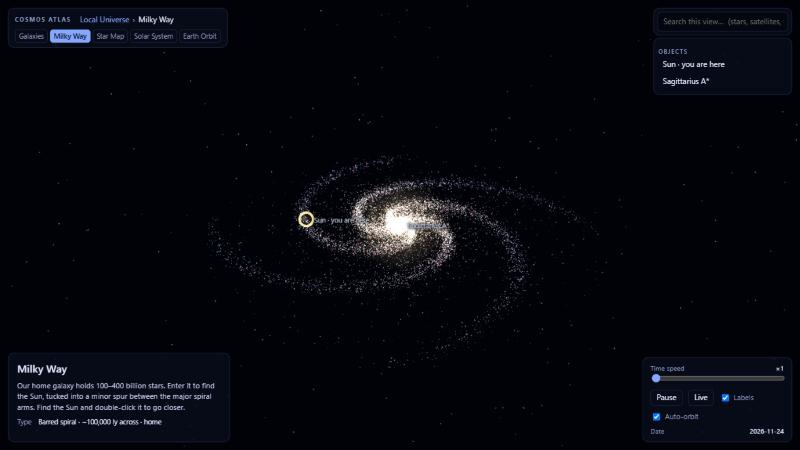
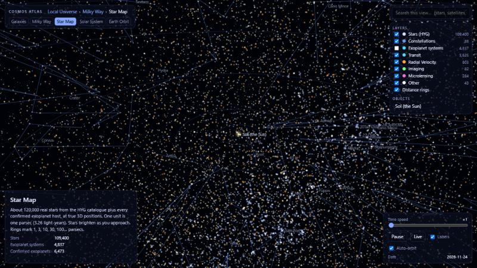
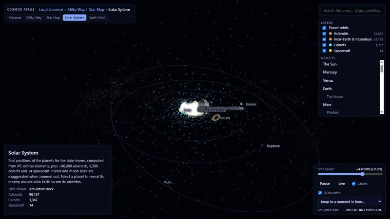
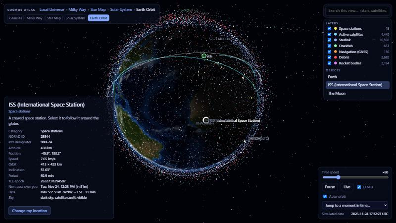

# Cosmos Atlas

[](https://github.com/joogiebear/space/actions/workflows/ci.yml)

**[Live demo: joogiebear.github.io/space](https://joogiebear.github.io/space/)**

| | |
| --- | --- |
|  |  |
|  |  |

*Left to right, top to bottom: the Milky Way, 109,000 real stars with constellation figures, the solar system with asteroids and comets, and ~20,000 satellites around Earth with the ISS's next pass over a chosen location.*

An animated WebGL atlas of the universe, from the local galaxy group down to the
satellites and debris orbiting Earth. Real data, drawn on the GPU.

| View | What it shows | Data |
| --- | --- | --- |
| Local Universe / Galaxies | Famous galaxies, shown as real photographs from afar; fly inside the Milky Way | Procedural stars, schematic positions; photographs from NASA, ESA, ESO and NOIRLab |
| Star map | ~109k real stars, 88 constellation figures, optional exoplanet host layer | HYG v4.0, Stellarium, NASA Exoplanet Archive |
| Solar system | Planets at their real positions, moons, ~96k asteroids, comets, spacecraft | JPL elements, SBDB, Horizons |
| Earth orbit | ~20k tracked satellites, stations, debris, rocket bodies; ISS follow, ground track and next-pass prediction for any selected satellite | CelesTrak (SGP4 / Kepler + J2 on the GPU) |

## Run

Requires Node 20+ and Python 3.9+ (standard library only).

```
npm install
npm run build          # type-checks (vue-tsc), then bundles the front end into dist/
python -m server 8080  # serves dist/ and the data API at http://localhost:8080
```

For development, run the data server and Vite side by side; Vite proxies `/api`
to the Python server and hot-reloads the front end at http://localhost:5173:

```
npm run api
npm run dev
```

Deep links: `#cosmos`, `#starmap`, `#solar`, `#earth`, `#gal:andromeda`.
`/atlas2d.html` is the original Canvas-2D version.

The server fetches and caches public data under `cache/` on first use (the first
load takes a minute). CelesTrak only allows one download per group every two
hours; the server keeps each group on disk and serves the last good copy if it
is rate-limited.

## Hosting

The live demo runs on GitHub Pages, which is free but static, so the Python server cannot run there.
Instead `.github/workflows/pages.yml` runs it once per deployment:

1. build the front end with `VITE_STATIC_DATA=1` (the data client reads `data/*.json` instead of `/api/*`)
   and `VITE_BASE=/space/` (the site lives under a sub-path),
2. run `python -m server.export dist/data`, which fetches every source with the same code and cache as
   the live server and writes the payloads as plain files,
3. deploy `dist/` to Pages.

It runs on every push to `main` and every 3 hours (CelesTrak refreshes every 2), and keeps `cache/` between
runs so a source that refuses the runner falls back to its last good copy. GitHub pauses scheduled workflows
after 60 days without repository activity; re-enable it from the Actions tab if that happens.

To host it elsewhere, run the two commands above with a different `VITE_BASE`, or deploy the Python server.

## Sky Tonight

The **Sky Tonight** tab shows the sky as it looks from your location at the simulated moment: the day and twilight sky,
12,000 stars with constellation lines, the Sun, the Moon with its true phase, and the planets. Select anything for its
altitude, compass direction, rise and set times, and brightness. The Time panel makes the sky turn.

The Milky Way is a photographic map: NASA's Deep Star Maps 2020 (built from ESA's Gaia star catalogue), converted to a
1.7 MB JPEG and drawn in galactic coordinates, blurred so its baked-in stars melt into a glow and the sky's own stars
stay sharp. It shows the Great Rift, the bright Sagittarius bulge and the dust lanes. If the image cannot load, a generated
glow in galactic coordinates (a thin bright disc, a wider faint one, a brighter bulge toward Sagittarius, and noise for
dust lanes) is drawn instead. It fades through twilight and is washed out by a bright Moon above
the horizon, as the real one is. It has a layer toggle. The photograph is cheap to draw. The generated fallback has a lighter
version for phones and slow frames (fewer noise layers, no grain: a third of the work per pixel).

While a meteor shower is on (within a few days of its peak, from the Sun's position), a ring marks its radiant, the point the
meteors seem to fan out from, labelled and selectable like any object. It shows its rise and set and how far from the
peak it is, and the calendar's meteor-shower entries open with it selected, at the hour it stands highest. Radiant
positions are the International Meteor Organization's values near the peak; the point drifts about a degree a day. There is
a layer toggle.

The space stations are drawn as they cross your sky (bright when sunlit against a dark sky, dim in Earth's shadow), and
any satellite can be found with search. Select one to see its next pass over you drawn as a line from where it rises to
where it sets, with its peak height. The summary shows when the ISS next passes. Orbit data only covers weeks around today,
so satellites hide for dates far from now.

Everything is computed in the browser (`src/lib/sky.ts`, with tests against almanac values): sidereal time and
precession, the Sun and planets from the JPL elements the solar system already uses, and an abridged lunar theory good to
about 0.3 degrees. Planet brightness is approximate (distance only, no phase terms). Your location is stored only in
your browser (set it from **Your location** in the Objects list); until then the sky is shown from Greenwich.

In the Local Universe view each galaxy is a real photograph (a layer toggle turns them off) that gives way to the generated
stars as you fly toward it, so you see the photograph from afar and the model up close. The Milky Way, which nobody can photograph from outside, shows NASA's artist's concept of it and is labelled an
illustration; the Cartwheel has no picture (no clean public image). Positions, sizes and orientation stay schematic;
the picture always faces you.

## Astronomy calendar

**Events** in the top bar lists what is coming up in the next 3 months, year or 3 years: eclipses, moon phases,
equinoxes and solstices, meteor shower peaks (with how much moonlight there will be), comets at perihelion, planet oppositions,
greatest elongations and close pairings, and rocket launches. Moon-and-planet pairings are off until you tick them. Opening an
event takes you to it: eclipses to Earth orbit at the moment of the eclipse, sky events to Sky Tonight from your
location at the best time that night.

Everything but launches and comets is computed in the browser (`src/lib/events.ts`, tested against almanac dates). Eclipses
come from NASA's published tables (`src/data/eclipses.ts`, 2025 to 2034); predicting one from a simplified lunar theory
could miss a marginal one. Moon phase times are good to about half an hour. Launches come from The Space Devs'
[Launch Library 2](https://thespacedevs.com/llapi) (free tier, refreshed every few hours by the site's data job) and are
optional: the calendar works without them.

Comets come from the JPL Small-Body Database (orbit, perihelion time and total magnitude, refreshed daily). The calendar
lists comets reaching perihelion within three years whose expected brightness is magnitude 10 or better, worked out
with the standard formula from the comet's distance from the Sun and from Earth. Comet brightness is notoriously hard
to predict and estimates run high, so the entry says "about". Only closed (elliptical) orbits are covered, and often
there is nothing to list: most comets are too faint. Also optional.

## Share links and tours

The address bar always carries the scene and the selected object (`#solar?sel=mars`). **Share** in the Time panel
copies a fuller link that also holds the simulated date, speed, pause state and camera, for example
`#solar?sel=mars&t=1969-07-20T20:17:00.000Z&r=1&pz=1&y=0.6&p=0.5&z=0.8`. Opening a link restores all of it; anything
unknown is ignored. The format is in `src/lib/view.ts`.

**Guided tours** (top bar, "Guided tours…") step through captions, moving the camera, the selection and the clock for
you: Next/Back, Pause/Play, Esc to leave. **Your sky tonight** is built when you start it, from your saved location and the real sky: it finds the Moon, the brightest planet and the brightest star that are up, runs a day in twelve seconds, then returns to real time. Tours are plain data in `src/scenes/tours.ts`, written in the same view format
as share links, so adding one means adding an entry to that list. The engine is `src/engine/tour.ts`.

## Tests

```
npm test            # Vitest, one run (jsdom, no WebGL needed)
npm run test:watch
```

Covered: pass prediction (`scenes/earth/passes.test.ts`: checked against satellite.js and
hand-built sun geometry for the visibility rules), the reactive store and its engine bridge
(`ui/bridge.test.ts`), toasts and the location dialog (`ui/toast.test.ts`), the simulation
clock (`engine/clock.test.ts`), and the date, orbit and colour helpers (`lib/lib.test.ts`).
Tests that touch the engine mock `engine/gl.ts` (see `src/test/glMock.ts`) since jsdom has no WebGL.

Touch gestures (`engine/gesture.test.ts`) and canvas sizing (`engine/viewport.test.ts`) are tested as plain logic.

### Browser smoke tests

```
npx playwright install chromium   # once
npm run e2e                       # builds the static site, serves it, runs desktop + phone projects
```

`e2e/smoke.spec.ts` drives the real production build in Chromium (software WebGL): it boots, the canvas fills the
screen and follows window changes, the keyboard works, and real two-finger pinch and one-finger drag gestures
neither select anything nor open a panel. CI runs it on every push.

## Code style

```
npm run lint          # ESLint (typescript-eslint + eslint-plugin-vue), warnings count as failures
npm run lint:fix
npm run format        # Prettier, writes changes
npm run format:check  # what CI runs
```

Prettier owns layout (120 columns, single quotes, semicolons) and ESLint owns correctness; `.editorconfig` makes
editors agree. CI runs lint, format check, type-check, tests and the build on every push and pull request.
The one big formatting commit is listed in `.git-blame-ignore-revs`; GitHub honours it automatically, and locally
`git config blame.ignoreRevsFile .git-blame-ignore-revs` makes `git blame` skip it too.

## Controls

| | Mouse | Touch | Keyboard |
| --- | --- | --- | --- |
| Look around | drag | drag | arrow keys |
| Zoom | wheel | pinch | `+` / `-` |
| Select | click | tap | Tab to the Objects list, or `/` to search |
| Go inside | zoom in on it, or double-click | zoom in on it, or tap "Enter" | `Enter` |
| Go back out | zoom out, or `Esc` | zoom out | `Esc` / `Backspace` |
| Pause time | Space | Time sheet | `Space` |

`?` shows the keys in the app. The time slider changes simulation speed (1x to 100,000,000x), and the "Jump to a
moment in time" menu (solar system and Earth views) jumps to historic events.

## Phones, accessibility and older browsers

- **Phones:** below 820 px wide (or 520 px tall) the panels become sheets above a bottom bar (Info, Layers, Time, Search),
  one open at a time. The breadcrumb row is dropped there (the view tabs reach every view) and the tab strip scrolls to
  keep the current view in sight.
- **Hover tip:** pointing at an object names it and says what it is; it flips to the other side of the pointer rather than
  run off the screen. Touch screens have no hover, so they tap for the info sheet instead.
- **Keyboard and screen readers:** the map is a focusable region, every control is reachable and labelled, view changes and
  messages are announced, the location dialog traps focus and returns it, and `axe-core` reports no violations. Text
  contrast meets WCAG AA. `prefers-reduced-motion` turns off auto-orbit and the dive transition.
- **No WebGL 2:** the app needs WebGL 2. Without it (or with graphics acceleration off) you get an explanation and a link
  to `/atlas2d.html`, a simplified 2D version with no WebGL and no network requests. A GPU reset reloads the page.

## Project layout

```
index.html              Vite entry: the canvas, label layer and the #app mount point
src/
  main.ts               Wires the UI, input, loop and first scene
  types.ts              Scene, Body, Layer, Preset: the contracts scenes implement
  lib/                  Pure helpers: math, Julian dates, orbital mechanics, colour, formatting
  engine/               Renderer, camera, picking, labels, input, clock, scene manager, render loop
  ui/                   Vue 3 panels: App.vue and components/ (TopBar, SearchBox, SidePanel, InfoPanel, TimePanel, ...)
                        store.ts holds the reactive state; bridge.ts copies engine events into it
  data/api.ts           Typed client for /api/*
  test/                 Test setup, a WebGL mock and fake scenes (tests sit next to the code they cover)
  scenes/               One folder per view; each registers itself
    galaxies/ starmap/ solar/ earth/   index.ts + shaders, data, presets as needed
  styles/               CSS split by area
public/                 Static files: planet textures, atlas2d.html
server/                 Python data server
  common.py             Paths, fetch, disk cache with stale fallback
  sources/              One module per upstream: celestrak, stars, exoplanets, smallbodies, horizons, constellations
  app.py                Routes and static serving
```

To add a view: create `src/scenes/<name>/index.ts` that builds a `Scene` and calls
`register(id, title, factory)`, import it in `src/scenes/index.ts`, and (if it
belongs in the navigation) add it to `PARENT` and `TABS` in `engine/sceneManager.ts`.

## Limits

Satellite positions use mean elements and are accurate to a few km, not
operational-grade. Galaxy positions and distances are schematic. Spacecraft
follow Horizons ephemerides over a window around the fetch date. The project
type-checks under TypeScript `strict`.

## Data and credits

Nothing below is bundled except the four planet textures; everything else is fetched by the
server at run time and cached locally.

- Satellite and debris orbital elements: [CelesTrak](https://celestrak.org) (Dr. T.S. Kelso)
- Stars: the [HYG database](https://github.com/astronexus/HYG-Database) (David Nash), CC BY-SA 4.0
- Exoplanets: [NASA Exoplanet Archive](https://exoplanetarchive.ipac.caltech.edu)
- Asteroids, comets and spacecraft tracks: [JPL Small-Body Database and Horizons](https://ssd.jpl.nasa.gov)
- Planet positions: JPL approximate Keplerian elements (1800-2050)
- Eclipse dates and times 2025 to 2034: [NASA GSFC Eclipse Web Site](https://eclipse.gsfc.nasa.gov) (Fred Espenak)
- Comet orbits and magnitudes: [JPL Small-Body Database](https://ssd-api.jpl.nasa.gov/doc/sbdb_query.html)
- Milky Way map: [NASA SVS Deep Star Maps 2020](https://svs.gsfc.nasa.gov/4851/) (NASA/Goddard Space Flight Center Scientific Visualization Studio; data from ESA/Gaia/DPAC)
- Rocket launch schedule: [The Space Devs, Launch Library 2](https://thespacedevs.com/llapi) (free tier)
- Constellation figures: Stellarium's "modern" sky culture
- Satellite propagation: [satellite.js](https://github.com/shashwatak/satellite-js); rendering: [three.js](https://threejs.org)
- Galaxy photographs (`public/assets/galaxies/`): NASA and ESA Hubble, Spitzer, GALEX, ESO and NOIRLab images, public domain or
  Creative Commons BY 4.0, credited per file in [`CREDITS.md`](public/assets/galaxies/CREDITS.md) and in each galaxy's info panel.
- Earth and Moon textures (`public/assets/tex/`) are processed NASA imagery: Blue Marble Next Generation and Black Marble
  from NASA Visible Earth / Earth Observatory, an Earth cloud layer from NASA's Scientific Visualization Studio (item 3615),
  and the LRO colour map from the SVS CGI Moon Kit (item 4720). NASA says texture maps made from its imagery are generally not
  subject to copyright in the US; see [`CREDITS.md`](public/assets/tex/CREDITS.md) for exact files and processing.
  This project is not affiliated with or endorsed by NASA.

The data sources have their own terms of use. This project is not affiliated with any of them.

## License

The code is [MIT](LICENSE) licensed. That covers this repository's source only: the data fetched at
run time and the NASA-derived textures keep their own terms (see above).
